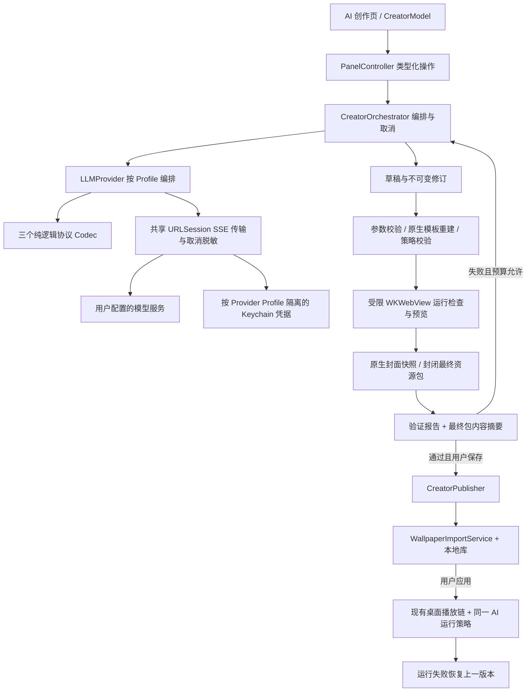

# AI 创作工坊：技术方案与 Codex 开发计划 v0.1

日期：2026-11-10  
状态：已补充存储与 Web 桥接合同，S0 可信模板流程已验证；任意代码隔离未通过。  
用户目标：先在本机跑通完整创作流程，再逐步发布。  
上游分析基线：`7025ba39f4c92f6c1af221aa3060c62aefb0e2a2`；S0/S1.0 本地安全基线：`e3a190c613ce2a95cff2816876b1c94319415f3f`（`feat/ai-creator`，未推送）。

配套文档：[S0 实测边界](../features/creator-s0.md) · [产品需求与验收编号](02-creator-prd.md)

第 1～13 节描述目标架构，包含后续阶段；S0 实际实现和测试结果以第 16 节及 [S0 验证报告](../features/creator-s0.md) 为准。本次计划修订已将 S1 固定为参数生成，并把自由代码合同、下载防护和不可合作脚本的终止能力列入 S4 解锁关口；S1.0 与 S1.1 的实现见阶段计划及第 17 节；S1.2 连接层见 [实施与验证](../features/creator-llm.md)。S1.3 参数合同与原生修订链见 [实施与验证](../features/creator-generation.md)；S1.4 原生编排、运行证据、封面和发布恢复见 [原生保存闭环](../features/creator-publication.md)；单次真实模型补充见下文，S2.2 原生 UI 已接入；可见外观、真实多轮修复仍未人工验收，S4 未实施。执行拆分见 [S1 与 S4 开发计划](2026-11-10-creator-s1-s4.md)。

S1.4 后续真机补充：用户以 openaiCompatible / kimi-k3 显式运行 `CreatorLiveSmokeTests`，结果 1 passed、0 failed、0 skipped。进入 S2.1 前已核对本地结果摘要；仅代表该 Profile 的一次创建/封面/保存闭环，不扩展到其他供应商或多轮修复。此次核对不发新请求，临时日志与结果包按要求清理。

S2.1 历史记录：已将核对通过的 S1.4 代码、文档及单次 live 补充固化为本地提交 `8c1480b0`（`feat/ai-creator`，未 push），提交后工作树干净。有限参数修复、对话账本和显式回退见 [S2.1 实施与验证](../features/creator-iteration.md)。该轮仅本地 Mock、内存凭据与离屏 WebKit；完成定向、一次完整门禁及文档检查后暂停，不进入 S2.2/S4，不提交该轮实现、安装应用或触碰桌面。

S2.2 历史记录：已将核对通过的 S2.1 代码和同步文档固化为本地安全基线 `29cd3086`（`feat/ai-creator`，未 push），提交后工作树干净。现已接入原生创作页、模型设置、独立预览与启动恢复；详细行为及边界见 [S2.2 实施与验证](../features/creator-workspace.md)。生成、保存入库和应用显示器是三个独立动作。当前备份格式不能原子携带 AI 策略，存在 Creator 数据时明确阻止旧备份/恢复/搬迁；不静默遗漏数据。常规验证只用 Mock、内存凭据及不显示的原生视图；可见外观、真实连接及桌面应用仍须另行授权验收。S2.2 当轮交付时保持未提交；现已在 S2.3 开始前固化为本地基线。

S2.3 最终收口（2026-11-11）：已将通过 4,962 项原生门禁的 S2.2 代码与文档固化为本地提交 `35594fb9`（未 push）。
本轮补齐无界面恢复、发布事务播放门禁、元数据凭据回显拒绝、AC-01～14 证据矩阵及基准/长稳入口，见
[S2.3 验收与复现](../features/creator-acceptance.md)。2026-11-11 已核对用户完成的真实测试：单次 smoke 通过；qwen3.8-flash-next / schema 的 30 个样本全部首次通过，首次及最终可运行率均为 100%；
三个模板完成 1800 秒离屏长稳，540 次采样全部响应正常，外连尝试和 WebContent 终止观察值均为 0。脱敏指标及最终常规门禁见验收记录。
S2.3 实测与最终常规门禁已完成：708 项 Python、4,994 项原生通过，0 失败、72 跳过；本次关闭全部 opt-in，未重发真实请求。按用户指令本地提交并暂停，不 push。S3 真机/UI/多屏/睡眠等待下一步授权，S4 自由代码保持关闭。

## 1. 总体结构

继续使用现有 SwiftUI/AppKit 架构，新增 Swift 领域服务。P0 输出仍为 `type: web`，不为了 AI 来源新增底层 WallpaperProjectType。是否需要桥接字段调整，以实际集成结果决定。



模型连接只存在于原生服务层。生成页面不获得 Key、网络请求代理或调用模型的桥接方法。生成结束后播放流程不依赖模型服务。

## 2. 已有接入位置与建议新增模块

以下是目标模块布局。原生模板、修订存储、模型连接、参数编译及 S1.4 封面/发布编排已实现；创作界面和后续扩展仍为规划，不应重复新建已有实现。

| 模块 | 建议位置 | 职责及集成注意 |
|---|---|---|
| 创作界面（新增） | `App/Views/ControlPanel/Creator/` | 工程、对话、状态、报告；不在 View 内读写文件或调用网络 |
| 页面操作（新增） | `App/Views/ControlPanel/Model/PanelController+Creator.swift` | 类型化异步操作和错误展示，遵守现有 `launch` 机制 |
| 页面导航（修改） | `ControlPanelView.swift`、`Shell/PanelTabs.swift`、`Shell/PanelDetail.swift` 等 | 增加 `.creator` 并完整处理标题、搜索、检查器和窄窗状态 |
| 创作服务（扩展 S0） | `App/Services/Creator/` | 扩展模板目录、工程修订、合同校验、封面、验证报告及发布恢复 |
| 模型服务（S1.2 已实现） | `App/Services/LLM/` | 共享 URLSession SSE 传输、取消/脱敏与三个纯逻辑 Codec：`openaiCompatible`、`anthropicMessages`、`geminiGenerateContent` |
| 凭据（复用） | `App/Services/Keychain/KeychainGenericPassword.swift` | 模型服务专用命名空间，按 Provider Profile 独立存储并绑定目标；host 变更不自动携带旧凭据，不复用 Steam/pixiv 凭据 |
| 运行策略（新增/修改） | `App/Services/WebWallpaper/` | `WebContentPolicy` / 工厂；策略须覆盖预览、桌面和恢复入口 |
| 草稿预览（扩展 S0） | `App/Services/Creator/CreatorPreview.swift`；`CreatorPosterService.swift` | 保留严格草稿入口，增加原生封面快照及过期回调检查 |
| 现有页面宿主（修改） | `App/Services/WebWallpaper/WebWallpaperWindow.swift` | 此文件定义 `WebWallpaperPage`；拆出配置/策略而非复制一整套页面实现 |
| 素材与模板 | `App/Services/Creator/CreatorTemplateCatalog.swift`、原生模板生成器；未来素材可用 `App/Resources/Creator/` | 当前目录、代码及资源上限由原生维护；素材包尚未开放 |
| 自动测试（新增） | `Tests/Unit/Creator/`、`Tests/Unit/LLM/` | 对应领域行为；Web 主机回归仍归原有测试域 |

`WallpaperPreviewLoader` 目前只接受位于正式库内且与 wallpaperID 匹配的项目；必须为草稿建立另一条严格校验入口。`WebWallpaperPreviewSurface` 已可复用独立存储、生命周期和默认静音等部分。现有诊断仅适合受限日志，应新增结构化事件输出，不能把日志文本当稳定接口。

## 3. 数据与文件约定

### 3.1 本地存储布局

通过 `ClientPaths` 集中增加路径，不散落硬编码：

```text
supportURL/
  CreatorSettings.json              # Provider Profiles：ID、协议、地址、模型、限额；无 Key
  CreatorRuntimeRegistry.json       # 已发布 AI 内容及策略映射

storageURL/
  Creator/
    Projects/<project-id>/
      project-meta.json
      conversation.json             # 本地记录，不默认导出
      Assets/<asset-id>.<ext>
      Revisions/<revision-id>/
        bundle/                    # 不可变渲染草稿或封闭包，按包状态限制入口
        revision.json
        validation.json
    Jobs/<job-id>/                  # 不完整输出，不能执行或发布
    Publication/                   # 沿用 S0 可恢复发布日志，不在 S1.1 重命名

libraryURL/
  ai-<project-id>/                  # 交给现有库的已发布项目
```

真实位置均由现有路径对象推导。创作素材可随可迁移存储区移动；设置和 Key 留在当前 Mac。发布暂存目录必须位于目标库所在卷，原子重命名不能跨卷。草稿历史位于库外，普通库扫描不得将历史修订列为多份壁纸。

首版无需数据库；使用版本化 Codable JSON + 原子写入、锁/actor 和恢复日志。文件量增长后再评估 SQLite。备份、恢复和存储搬迁涉及的新数据必须明确支持或明确跳过，不能静默丢失运行策略。

### 3.2 核心对象

| 对象 | 最小字段 |
|---|---|
| `CreatorSettings`（S1.1 已实现） | `schemaVersion, revision, profiles[], selectedProfileID`；有界、无 Key，原子写入和并发版本检查 |
| `ProviderProfile`（S1.1 元数据已实现） | `schemaVersion, id, configurationRevision, configurationID, name, protocolKind, baseURL, model, localMode, capabilities, limits`；Key 与确认目标绑定由 S1.2 的独立 Keychain 服务管理 |
| `CreatorProject` | `schemaVersion, id, title, createdAt, latestRevisionID, lastValidatedRevisionID, publishedWallpaperID` |
| `CreatorRevision` | `id, parentID, promptSummary, providerID, modelID, outputSchemaVersion, generation?, seal?, bundleVersion, sdkVersion, templateID, templateRevision, normalizedParameters, renderDigest, posterDigest, bundleDigest, createdAt` |
| `GenerationJob` | `id, projectID, baseRevisionID, baseRevisionDigest?, state, attemptCount, requestBudget, tokenBudget, reservedOutputTokens?, cancellationToken, iterationID?` |
| `CreatorConversation`（S2.1） | `schemaVersion, projectID, turns[]`；轮次含配置/基线绑定、预算、repairCount、attempts、原生 issue 与修订引用；本地原子 JSON + 整轮租约 |
| `ValidationReport` | `revisionID, renderDigest, posterDigest, bundleDigest, policyVersion, templateRevision, sdkVersion, hostVersion, testProfile, results[], measuredMetrics, validatedAt` |
| `CreatorRuntimeRegistry`（S1.1 已实现） | 版本化 `entries`，保留 v1 登记兼容；S1.4 的 v2 Binding 增加最终 ValidationReport，原子比较替换与回滚 |
| 发布记录（S1.4） | `CreatorPublisher.Journal` 保存 candidate/previous 摘要、前后 Binding 和 prepared/installed/confirmed；`CreatorRuntimeRegistry.Binding` 保存当前发布修订 |
| `ApplyAttempt` | `targetDisplayIDs, previousAssignments, candidateRevisionID, state, failureReason` |

内容摘要应对按稳定顺序排列的**相对文件路径和真实字节内容**计算，而非只看大小和修改时间。现有 `WallpaperProjectRevision` 使用文件元数据生成指纹，适合变更缓存，不直接作为“测试的就是这份代码”的内容证据。

通过报告绑定资源包、宿主/SDK/策略版本及测试尺寸/属性范围。宿主升级或文件变化使相关报告过期。应用前至少确认包摘要一致；运行器持有不可变内容快照，避免检查后文件被替换。

## 4. 模型输出合同

P0 / S1.2 改为共享底层 `URLSession` SSE 流式传输与取消/脱敏控制，加三个纯逻辑协议 Codec：`openaiCompatible`、`anthropicMessages`、`geminiGenerateContent`。供应商与模型差异由 Provider Profile 显式描述；每个 Codec 均需合同测试，不能假设“兼容”意味着所有字段一致。第 4.1～4.3 节保留输出与包合同，第 4.4～4.7 节定义传输、协议及凭据边界，相关传输、凭据和 Codec 已在 S1.2 实现并以隔离测试验证，真实端点与系统 Keychain 权限未联调；Profile 元数据已在 S1.1 实现，见第 17 节。

S1.2 实际原生接口（省略 Swift 类型注解）：

```text
LLMProvider.generate(request, profileID, configurationID, ticket, store) async throws -> Completion
LLMProvider.cancel(ticket)

Completion = response(text, optional usage) + profile + ticket + attempts + reservedOutputTokens + elapsed
```

本阶段传输内部按片消费，但调用方只接收完整结果；诊断回调仅发出有界的 started/retry/completed/failed 事件，不暴露部分正文或思维内容。未来 UI 的进度展示另行接线。返回 `Completion` 仅表示传输与协议完整结束；答案还须经过 S1.3 参数校验，不能直接视为已验证或可发布修订。

### 4.1 S1 实施合同：TemplateParameterOutput v1

S1 仅接受一个完整的纯 JSON 对象，不接收 HTML、JS、CSS、GLSL、表达式、文件路径或能力授权。模板代码和控件定义由原生目录维护；模型只选择已知模板和填写受限参数。因此不再把大段源码装进 JSON 字符串，但仍需处理 JSON 本身的截断、无效枚举和格式错误。

下面的 `stars-v2` 已由 S1.0 原生目录实现；S1.3 同时支持 `gradient-v2`、`stars-v2`、`clock-v2`。模型输出版本 `schemaVersion: 1`、模板版本和资源包版本分别管理。枚举使用目录中的原值，例如 `bottomLeft`，不做拼写猜测或隐式转换。

```json
{
  "schemaVersion": 1,
  "templateID": "stars-v2",
  "title": "深蓝流星夜",
  "summary": "三层缓慢星空，偶有流星，左下角显示时钟",
  "parameters": {
    "starDensity": 0.55,
    "starSizeSpread": 0.6,
    "trailLength": 0.25,
    "parallaxLayers": 3,
    "twinkleHz": 0.4,
    "meteorRate": 2,
    "primaryHue": 220,
    "secondaryHue": 275,
    "motionSpeed": 0.35,
    "clockVisible": true,
    "clockAnchor": "bottomLeft",
    "clockScale": 0.9
  },
  "properties": {
    "starDensity": {"default": 0.55},
    "motionSpeed": {"default": 0.35},
    "clockVisible": {"default": true},
    "clockAnchor": {"default": "bottomLeft"}
  }
}
```

| 字段 | Schema 约束与原生处理 |
|---|---|
| `schemaVersion` | 必填整数，固定为 1；S1 拒绝 v2 自由代码输出 |
| `templateID` | 必填，原生模板目录枚举；不能接受 URL、路径或未安装版本 |
| `title` / `summary` | 必填纯文本，分别 1～60、1～240 个 Unicode 标量；显示时不解释成 HTML/代码 |
| `parameters` | 必填字典，按 `templateID` 选择独立 Schema；键、类型、范围、枚举均由原生定义，所有参数完整给出 |
| `properties` | 必填字典，可为空；只允许该模板已定义控件 ID 的子集，每项仅含 `default`，必须与对应参数值一致 |

根对象和每层字典均设置 `additionalProperties: false`；重复键、非有限数值、隐式字符串转数字、未知模板/字段、默认值冲突、超过 16 KiB 的 UTF-8 响应均拒绝。原生控件目录决定类型、标签、范围、排序及参数映射，模型不能扩大范围或注入事件处理器；省略的控件默认值从 `parameters` 补齐，显示哪些控件仍由模板目录决定。S1.3 的 `CreatorOutputSchema` 和 `CreatorOutputValidator` 均直接读取原生目录，并测试类型、范围、枚举及预设的一致性。JSON Schema 描述字段与取值；控件默认值等于参数的跨字段约束由 Swift 再验证。`uiStep` 仅为控件步长，不额外限制为倍数。供应商 JSON 模式只用于降低出错率，本地校验仍是准入条件。

S1.3 接收协议正常结束后的完整回答。仅兼容剥离覆盖整个回答的一个 `json` 或无语言 Markdown 代码围栏（支持 CRLF）；不从说明文本搜索 JSON，不拼多段、不补括号。16 KiB 上限包含外层空白与围栏；字节解析器另限嵌套深度 8、节点数 4,096，按解码后的键拒绝重复键。标题/摘要拒绝空白、控制字符和双向文本控制；永远只作元数据，不作 HTML 或路径。

缺失、类型/范围、格式、默认值不一致等归为 `malformedOutput`；未知模板/字段、版本、代码/路径/能力扩张归为 `policyViolation`。v1 只有上表六个根键，素材与能力白名单为空，`assets`、`capabilities`、`files` 即使为空也拒绝。完整静态校验通过前不创建候选包；S1.3 单独调用不自动请求模型；S2.1 编排可在同一轮次预算内修复，见第 20 节。传输只提供有界进度事件，不向调用方暴露或执行流式正文片段。

`CreatorPromptBuilder` 从目录导出类型、范围、枚举、单位、默认值、六套预设及固定资源预算，构建 System Prompt。用户描述上限 2,048 UTF-8 字节，完整请求文本上限 16 KiB。指定基线时只带该修订的参数和标题/摘要，保存其元数据摘要用于暂存/提交前复核；不偷换为最新修订，不带 Key、主机地址或本地路径。原始 S0 的两参数模板需显式升级；S1.0 的 v1 包含 v2 模板目录时可直接派生 v2 包。

### 4.2 后续自由代码合同：CodeBundleOutput v2

**待 S4 隔离关口全部通过后启用，S1～S3 不解析或执行此合同。** 采用“JSON 元数据头 + `<file path="…">` 原始代码分块”，源码不作为 JSON 字符串值。下面是应用协议草案，非 Wallpaper Engine 标准，也不是可直接当 XML 解析的文档。

```text
{"schemaVersion":2,"templateID":"canvas2d-sdk-v1","title":"深蓝星空","summary":"固定 SDK 下的效果模块","files":[{"path":"main.js","mediaType":"text/javascript"}],"capabilities":["canvas2d"]}
<file path="main.js">
export function render(frame) {
  frame.clear();
}
</file>
<end-bundle/>
```

元数据 Schema 仅描述版本、纯文本信息、允许的相对路径清单和能力请求；不包含 `content` 字段。能力请求不等于授权，宿主骨架、CSP、SDK、运行策略及原生桥接仍由应用生成。每个文件必须在头部清单出现且恰好一个块，缺块、重复路径、尾部文本、缺失终止标记均拒绝。

分块解析必须有明确状态机和流量上限，不能用一个正则“找标签”。示例的闭合标签与终止行属于保留分隔符：源码含有可造成歧义的完整分隔行时拒绝，不静默截断或转义改写源码。S4 冻结协议前比较带原生随机边界的分帧或长度帧，覆盖字符串内标签、分隔符跨网络分片、UTF-8 多字节截断、重复块及取消；摘要与最终字节数由本地计算，不以模型自报作为完整性证明。

自由代码合同初始上限为最多 20 个文本文件、单文件 256 KiB、总计 1 MiB；这些限制不套用到 S1 的短参数 JSON。拒绝绝对路径、`..`、空路径段、链接、大小写/Unicode 规范化碰撞、NUL、非允许类型及可执行二进制。只有完整封闭、检查通过的包才能进入受限运行器。

### 4.3 S1 原生封装与 preview.jpg

S1 由原生模板编译器封装，不由模型生成文件。S1.3 已生成 `bundleVersion: 2`、`packaging: renderDraft` 的三文件草稿；模型参数同步映射为 `project.json.general.properties[*].value`。可选 `presentation` 记录纯文本标题/摘要，参与确定性重建和摘要，不进入脚本；字段缺失时保留原 v2 字节。S1.4 已实现的封闭发布包为：

```text
project.json
index.html
creator.json
preview.jpg
```

S0 的读取器严格接受三个固定文件；不能直接允许任意额外文件。S1.1 先引入独立的 `bundleVersion: 2` 和明确的四文件清单，保留 S0 v1 读取与显式迁移；S1.4 已通过原生封面服务签发完整证据，只有四文件 sealed 包及匹配报告可进入发布。代码及参数清单按模板版本逐字节重建；`preview.jpg` 是原生派生的非执行资源，另验 JPEG 解码、尺寸、字节数和记录摘要。包摘要存于修订/验证记录中，避免清单自包含自身摘要形成循环。

渲染草稿和可发布包使用不同的准入状态：原生校验过、尚缺封面的草稿可以进入专用预览入口，正式库入口只接受已封闭的完整包。原生编排器将运行检查绑定到 `renderDigest`，生成封面后确认可执行内容未变，再签发绑定 `posterDigest` 和最终 `bundleDigest` 的报告；不能复用旧的三文件报告直接放行四文件包，也不能由模型填写“已封闭”状态。

兼容现有导入链的清单示例（属性元数据由原生目录生成）：

```json
{
  "title": "深蓝流星夜",
  "type": "web",
  "file": "index.html",
  "preview": "preview.jpg",
  "general": {
    "properties": {
      "starDensity": {
        "order": 0,
        "text": "星点密度",
        "type": "slider",
        "value": 0.55,
        "min": 0,
        "max": 1
      }
    }
  }
}
```

AI 修订信息放在独立元数据中，不发明 `type: ai`，不冒用 Workshop ID。正式目录 ID 与 S0 的路由规则必须有版本化迁移；不能因为更换目录名就回退到宽松宿主。

封面流程：运行检查通过 → 固定当前修订、参数、视口和页面代次 → 等待首帧就绪 → 原生 `WKWebView.takeSnapshot` → JPEG 编码与校验 → 原子写入 `preview.jpg` → 写入清单 `preview` 字段 → 冻结最终包 → 计算最终摘要与发布报告。不能先发放通过摘要再追加封面。

“首帧稳定”指页面加载、布局/字体及绘制已就绪，不要求动画的连续帧像素相同。以原生快照成功且可解码作为必要证据，不能只相信页面自报 ready。已实施限制为页面加载/首帧/快照等待至多 5 秒，不自动重拍；JPEG 超限时仅尝试一次更低质量编码，不再请求模型。编码后长边不超过 1280 像素、JPEG 不超过 512 KiB；视口保持用户选择的比例。`snapshotWidth` 的单位是点，必须验证编码图片的实际像素尺寸。整体快照应包含时钟等 DOM 图层，不能只导出 Canvas 冒充完整封面。[Apple 快照接口](https://developer.apple.com/documentation/webkit/wkwebview/takesnapshot%28with%3Acompletionhandler%3A%29)、[快照配置](https://developer.apple.com/documentation/webkit/wksnapshotconfiguration)。

S1.4 已实测没有 NSWindow 的整页快照，覆盖三套 v2 模板与旧 S0 DOM 时钟，并从 `LibraryPreviewFetcher` 读回正式包封面。原生 32×32 网格检测至少 922/1024 不透明样本及两种量化颜色，避免仅依赖 JS 自报。初始化确认完整属性、fps、暂停与字体就绪，再冻结当前帧并重绘；这里的确定性指参数/布局/绘制顺序，不保证动画或时钟在不同时刻的 JPEG 字节相同。失败、空白、编码超限、超时或取消保留草稿并停止页面；旧回调不能复活会话。无桌面截图或开窗。

### 4.4 共享传输层与纯逻辑 Codec

P0 / S1.2 已实现 `openaiCompatible`、`anthropicMessages`、`geminiGenerateContent` 三个协议 Codec，复用一套底层 `URLSession` SSE 流式传输、取消、限额、错误分类和脱敏控制。这里的三个协议不是三个独立网络客户端，也不代表已经完成三家线上供应商联调。具体服务地址、模型及能力差异保存在 Provider Profile 中；协议正确性先用固定响应和注入传输验证。

| 层 | 职责与边界 |
|---|---|
| `ProviderProfile` | 稳定 `profileID`、协议枚举、base URL、模型、本地模式、协议能力开关和限额；不含 API Key |
| `LLMProvider` | 按任务和 Profile 选择 Codec，汇总事件；不产生另一套供应商专属网络实现 |
| 共享 `LLMStreamTransport` / `SSEParser` | `URLSession` 请求生命周期、SSE 字节分帧、取消、超时、限额、拒绝重定向及统一错误；注入 session configuration / Mock URLProtocol |
| 三个纯逻辑 `LLMProtocolCodec` | 从原生请求生成不含秘密的请求描述（相对端点、普通头、JSON body、鉴权头类型），并把 SSE 事件归一化为正文、用量和结束/错误事件；不访问网络、Keychain、磁盘或 UI |
| `ProviderCredentialStore` | 在目标和配置校验后按 Profile 读取 Keychain，并将凭据注入原生请求头；凭据值不经过 Codec，不交给模型输入或页面 |

每个请求维护独立的 Codec 状态，状态作为显式输入/输出，不跨请求共享缓冲、思维块状态或 token 累积。当前使用每请求独立的 ephemeral URLSession，禁用系统凭据库、Cookie 和缓存；TLS 保持系统验证，不接受其他自动鉴权挑战。正文只在合法结束和完整 JSON object 校验后交回原生调用方；S1.3 增加单一完整围栏兼容，并由独立严格校验器拒绝重复键、未知字段及模板参数错误。

共享传输按实际 UTF-8 字节增量处理分片、多行 `data:`、空行分隔、LF/CRLF、注释/心跳及末尾残帧。SSE 分帧与协议 JSON 解码分开；不能把一个网络分片直接当成完整 JSON。正文最终仍受 16 KiB 合同上限约束；原始流上限 1 MiB，单行/单事件上限 64 KiB，默认请求总超时 60 秒（可注入但不超过 600 秒；按需基准默认 90 秒）。被跳过的思维数据、注释和未知 SSE 字段也计入传输限额。取消/结束释放会话，迟到事件不能替换终态。

取消必须终止对应 `URLSessionTask` 和消费流，释放缓冲；复用 S1.1 的 `jobID + cancellationToken` 并绑定 Profile 配置代次，丢弃迟到事件。401、429、超时、HTTP 错误及流内错误走同一分类/预算规则，不在 Codec 内自动重试；未结束、截断、取消、拒绝或 token 上限停止都不能变成成功结果。协议结束标志由 Codec 判定，不能只凭连接 EOF 或已经收到一些正文宣布完成。

鉴权头、URL 中的敏感值、原始请求/响应与错误体不直接进入日志或诊断导出；只记录允许字段、脱敏错误及有界计数。三协议都只将最终答案正文送到 S1.3；思维内容不进入参数 JSON、页面、工程或日志。过滤不改变供应商计费用量，缺失用量用 optional/未知表达，不能填 0。流式片段始终不执行，也不创建可发布修订。

### 4.5 三协议请求与响应边界

#### openaiCompatible

- 首版协议范围为 Chat Completions SSE（`chat/completions`），不是 OpenAI Responses API。使用 `Authorization: Bearer <Key>`；系统约束放入该协议支持的 system 消息。
- 默认强制 HTTPS 和非空 Key。**仅显式本地模式且规范化 host 严格等于 `127.0.0.1`、`localhost` 或 `::1` 时，允许 HTTP 与空 Key**；IPv6 URL 使用 `[::1]`，比较时去除方括号。空 Key 时省略鉴权头，不发送空 Bearer。HTTPS 本地地址也只有满足该显式模式和白名单才可空 Key。
- 不将 `127.0.0.0/8`、内网地址、`0.0.0.0`、相似域名、DNS 恰好解析到回环的远程域名或其他 IP 表示法自动视为本地。URL 禁止 userinfo/凭据 query，TLS 验证不得关闭；HTTP 例外不扩散到另外两个 Codec。
- 请求设置 `stream: true`，支持 `stream_options.include_usage: true`。Profile 可显式声明本地端点不支持该请求字段；此时省略选项，不自动发第二次请求试探。即便请求了用量，也接受本地正常结束但不返回 usage 的流，显示“未知”。不能因为缺少用量放宽结束/完整性检查。
- Profile 的可选 `jsonMode` 为 `automatic` / `required` / `schema` / `disabled`，缺省等于 automatic 并保留旧记录字节。automatic 在原生请求携带结构约束时发送 `response_format: {"type":"json_schema","json_schema":{"name":"template_parameter_output_v1","strict":true,"schema":...}}`，无约束的通用请求保留 json_object；required 明确要求 json_object，schema 要求原生 Schema 并强制 json_schema，disabled 省略 response_format。required/schema 均不降级。
- 请求用 Schema 由原生目录单独导出：根对象封闭、字段全必填、parameters 内嵌 anyOf 三个完整模板字典、裸标量类型/枚举、properties 固定为空对象；不直接发送含 `$schema`/`$defs`/根 oneOf/const/allOf 的完整合同。范围、文本、跨 templateID 匹配和资源上限继续由原校验器强制检查。完整 `CreatorOutputSchema` 和 `CreatorOutputValidator` 合同不变；Prompt 给出扁平骨架及原生默认值生成的完整时钟例子，明确 backgroundMotion、无 motionSpeed/clockVisible，避免跨模板抄键。
- 仅服务端 400 的结构化错误明确报告 `response_format`、`.type`、`.json_schema` 或 `.json_schema.schema` 及 unsupported/unknown 参数码时，automatic 可在同一预算内直接降级为纯提示词一次；不根据自由错误文案猜测、不对 401、invalid_json_schema 或无关 400 试探。按需 smoke/benchmark 均支持四种模式且默认 automatic；smoke 的 requestBudget=1 不因此放宽。当前发送 `max_tokens`，不自动猜测其他模型专属请求字段。
- 只收集选定 choice 的答案正文；接受最后 `choices: []` 的 usage 专用块，忽略中间 `usage: null`，保留请求级用量而不逐块累加。收到 `finish_reason` 后仍需处理末尾用量及 `[DONE]`，不能提前关闭流。详见 [Chat Completions 请求及用量](https://developers.openai.com/api/reference/resources/chat/subresources/completions/methods/create) 与 [流式事件](https://developers.openai.com/api/reference/resources/chat/subresources/completions/streaming-events)。
- 过滤兼容端点的 `reasoning_content` 和显式思维块；这些是兼容扩展，不是所有 OpenAI 服务都返回的字段。对于 Profile 声明的前置 `<think>…</think>` 等包裹，使用跨分片状态处理，在输出首个 JSON 字符前剔除；不对 JSON 字符串中的普通文字做全局正则删除。思维块不闭合、未知包裹或结构歧义按无效/截断响应拒绝，不猜测正文边界。

#### anthropicMessages

- 使用 Messages SSE：`POST /v1/messages`、`stream: true`，鉴权为 `x-api-key`，并发送显式 `anthropic-version` 头。API 版本由协议配置固定并纳入合同样例，不依赖服务端隐式默认值。要求 HTTPS 和非空 Key。
- 系统提示使用请求顶层 `system`；不得伪装成 `messages` 数组中的 `role: system`。`model`、`max_tokens` 与普通 user/assistant 消息按 Messages 合同编码。[Messages 请求](https://platform.claude.com/docs/en/api/http/messages/create)
- 从 `message_start.message.usage` 初始化统计，再用 `message_delta.usage` 中出现的字段更新同一次请求的统计。`message_delta` 的 token 值是累计值，不能把起始值、每个 delta 和最终值再次相加；缓存用量等分项保留各自语义，缺失字段不清零。[流式事件与累计用量](https://platform.claude.com/docs/en/build-with-claude/streaming)
- 按内容块 index 跟踪类型，只收集 `text` 块的正文（包括 start 中已有文本及后续 `text_delta`）；跳过 `thinking` / `redacted_thinking` 块及 `thinking_delta`、`signature_delta`。`ping` 不产生正文；流内 `error` 终止任务；在合法停止原因和 `message_stop` 后才完成。首版不启用工具调用，不把工具参数增量当成答案 JSON。

#### geminiGenerateContent

- 要求 HTTPS 和非空 Key，**强制使用 `x-goog-api-key` 请求头，禁止在 URL query 中传 Key**，包括连接测试、重试及重定向。Profile URL 中已有 `key`、`api_key` 等凭据参数时在发送前拒绝；不能先发送再从日志删除。
- 使用 `POST /v1beta/models/{model}:streamGenerateContent?alt=sse`，model 作为受校验的单一路径段编码，不能夹带路径或 query。请求顶层使用 `systemInstruction`；设置 **`generationConfig.responseMimeType = "application/json"`**，`responseMimeType` 不是请求顶层字段。普通对话进入 `contents`。[GenerateContent 请求及 JSON 模式](https://ai.google.dev/api/generate-content)
- 只拼接选定 candidate 的 `content.parts` 中 `thought` 不为 `true` 的文本；跳过 `thought=true` 思维块及 thought signature 等非正文信息。解析 `usageMetadata`，保留提示/候选/总量及可用的思维用量分项；若多块重复携带请求级统计，合并快照而非逐块求和，缺失字段标记未知，不从可见文本估算账单。[Gemini 思维内容](https://ai.google.dev/gemini-api/docs/thinking) 与 [响应及用量元数据](https://ai.google.dev/api/generate-content)
- SSE JSON 事件不套用 OpenAI 的 `[DONE]`。结合 candidate 的 `finishReason`、流完整结束及末尾用量判断完成；空候选/`promptFeedback` 拒绝、非正常停止原因和提前断流须明确区分，不能仅凭 HTTP 200 或 JSON 模式声明放行。JSON 模式仍须经过 S1.3 严格本地 Schema 验证。

### 4.6 Provider Profile 凭据与主机变更

Keychain 在模型服务专用命名空间中按 **Provider Profile 的稳定 `profileID` 独立存储**，不能只按协议名、供应商名或当前 host 共用一个 Key。即使两个 Profile 使用同一协议和主机，也不隐式共享凭据；复制 Profile 不复制凭据关联。设置 JSON、工程、任务、修订、日志及导出均不保存 Key。

凭据绑定经用户确认的目标 origin（至少包含规范化 host，另包含 scheme/有效端口），绑定信息与凭据由原生凭据服务维护，不能由编辑后的 Profile 自行证明新目标已获授权。**修改目标主机（host 变更）时，禁止自动携带旧凭据发送请求**：使当前凭据关联失效、取消旧配置任务、递增配置代次，并在用户针对新目标显式重新绑定/填写凭据前阻止连接测试和生成请求。保留旧 Keychain 项不等于允许把它发给新主机；失败重试和恢复任务同样不能携带旧关联。改变 scheme/端口也重新核对绑定，禁止 HTTPS 自动降级。

共享传输在读取凭据和实际发送前核对 Profile 代次与目标；自动重定向不得跨 host/origin 转发鉴权头。跨目标重定向直接拒绝，不自动读取另一 Profile 的 Key，也不改用 URL query；S1.2 进一步拒绝同 origin 重定向：固定 POST 端点不自动改变方法或路径，`URLSessionTaskDelegate` 在转发之前返回 nil 并取消任务。URL 的 host 比较使用解析后的规范化值，禁止字符串前缀判断，以免把 `localhost.example.com` 等当作本机。

S1.2 凭据服务使用 `WallpaperMachine.Creator.ProviderCredentials.v1` 命名空间、Profile UUID 作为 account；Keychain 内绑定 profileID、origin、configurationID/configurationRevision 及完整 Profile 摘要。base path、模型、能力或限额变化也要求显式重新绑定，删除后复用 ID 不能复活旧 Key。实际发送在 `CreatorSettingsStore` 同一文件锁下复核最新完整 Profile 后才 resume；同进程设置/凭据/任务变更同步取消飞行请求，其他进程或外部文件替换在有任务时每 100 ms 复核。已经发送的数据无法撤回；测试未验证跨进程系统 Keychain 通知或真实服务计费。

请求预算复用 `GenerationJob`：每次发送前原子增加 attemptCount 和可选 reservedOutputTokens，旧字段缺失时保留规范 JSON 字节；已消耗次数却没有预留明细的旧任务不能获得免费重试。1～3 次请求预算包含重试与一次 JSON 模式降级，累计最大输出预留受 Profile/job 中较小预算约束。401/403 不重试；429 解析秒数或 HTTP-date 的 Retry-After，超过 30 秒直接报告且不擅自缩短；5xx 按有界退避重试。缺失用量为未知，当前只交付最后成功请求的统计，不称为整个任务账单；S1.3 单独调用不自动修复参数；S2.1 编排将整轮预算上提到 CreatorConversation，关闭 Provider 内部重试，每个子 Job 只有一次请求；兼容降级和传输重试走同一个外层预算，见第 20 节。

### 4.7 S1.2 协议与凭据验收矩阵

下表已由 S1.2 的 `SSEParserTests`、`LLMCodecTests`、`ProviderCredentialStoreTests`、`LLMProviderTests` 和 `LLMStreamTransportTests` 覆盖，使用内存 Keychain 与截获所有地址的 Mock URLProtocol。验证结果及未覆盖的真实系统边界见 [连接层实施与验证](../features/creator-llm.md)。S1.1 的元数据检查不替代这些网络/凭据合同测试。

| 层/协议 | 必须覆盖 |
|---|---|
| 共享 SSE | 多字节跨片、多事件同片、多行 data、LF/CRLF、心跳、末尾残帧、过滤前后字节限额；取消底层任务、迟到事件、HTTP/流内错误及有限重试 |
| `openaiCompatible` | Bearer；HTTPS 默认；三个允许 host 与显式本地模式的组合；HTTP/空 Key 反例；`include_usage`、空 choices、usage null、无用量正常结束；reasoning 字段及跨片思维块过滤 |
| `anthropicMessages` | 两个必需头、顶层 system；message_start + 多次累计 message_delta 不重复计数；text/思维块交错、签名、ping、error、message_stop、截断 |
| `geminiGenerateContent` | 请求头传 Key，URL 不含凭据；alt=sse、顶层 systemInstruction、generationConfig 内 JSON MIME；thought=true 过滤；usageMetadata、finishReason、拒绝与提前断流 |
| Profile / Keychain | 同协议同 host 的两个 Profile 不串 Key；host 变更、配置代次、取消/重试/恢复、跨主机重定向均不发送旧凭据；复制 Profile 不复制凭据关联 |
| 共享输出 | 只向 S1.3 交付完整答案；三协议用量缺失均为未知；思维内容与凭据不出现在参数 JSON、持久化文件、日志或诊断中 |


## 5. 固定创作 SDK 与能力约束

S1 的 SDK 和绘制内核由应用提供并接受审查，模型只输出参数；S4 解锁后才讨论模型编写效果模块。二者共用暂停、缩放、调参和销毁合同：

- 提供画布尺寸、时间增量、统一动画循环、暂停/恢复和销毁回调。
- 对接 `window.wallpaperPropertyListener.applyUserProperties`、`applyGeneralProperties`、`setPaused`。
- 模板默认使用 `requestAnimationFrame`，暂停时释放/停止自身工作，限制分辨率和粒子数量。
- 只通过已授权资源 ID 获取素材；不提供磁盘、Shell、Keychain 或任意网络桥接。
- 时钟使用本机时间，无须联网；属性值进行类型、范围与长度校验。
- P0 不支持 iframe、worker、WASM、动态下载依赖、远程字体和脚本。WebGL 扩展在后续固定模板中验证。

### 5.1 S1 模板表现力门槛

新增 S1.0，在连接真实模型前把三个 S0 验证例子升级为高表现力固定模板，每个提供 **8～12 个作用可区分的参数**。优先扩展可信 Canvas2D/粒子内核；若采用固定着色器，着色器必须随应用发布，并单独验证 WebGL、快照和降级行为，不能接收模型 GLSL 或表达式。参数模式降低代码执行风险，但模板自身仍需要代码审查、资源上限和回归测试，不宣称“百分之百安全”。

| 模板 | 拟定可控维度 | 非调色验收重点 |
|---|---|---|
| `gradient-v2` | 主/副色相、渐变角、对比度、运动速度、波纹尺度、波纹强度、颗粒量、呼吸频率、暗角强度（10 项） | 方向、空间结构、纹理和运动节奏可分别改变 |
| `stars-v2` | 星点密度、大小分布、拖尾长度、视差层级、闪烁频率、流星频率、主/副色相、运动速度、时钟开关、九宫格锚点、时钟缩放（12 项） | 密度、尾迹、深度、事件频率和布局都可感知地变化 |
| `clock-v2` | 主/副色相、背景运动、时钟锚点、缩放、12/24 小时制、秒显示、日期显示、内置字体枚举、辉光强度（10 项） | 排版、信息量、位置和背景动效可分别改变 |

`stars-v2` 的参数 Schema 初值：密度/大小分布/拖尾为 0～1；层级为整数 1～4；闪烁为 0～3 Hz；流星为每分钟期望 0～6 次；色相 0～360；速度 0～2；时钟缩放 0.5～1.5；开关为布尔值，锚点为固定九宫格枚举。随机种子、粒子/尾迹总预算、最大并发流星、绘制像素和 FPS 限额由原生性能档决定，不由模型指定；不能让层数与密度相乘绕过总预算。

每个模板至少提供两组视觉差异明显的内置预设。使用固定种子和测试时钟，逐个验证参数影响、最小/默认/最大值及组合最坏输入；非数值、越界及未知枚举拒绝。画面变化与资源上限分别验收，普通测试不调用模型。若单个模板尚不足 8 个有效维度，就不把接入模型当作它已经达到产品体验门槛。

SDK 是可靠性约束，不是恶意脚本的隔离边界。S4 的非合作代码即使不遵守 SDK，也必须能被外部监督器停止；这项能力尚未通过，不能由 S1 的可信模板测试代替。

## 6. AI 内容运行策略

### 6.1 与现有兼容模式分离

区分三种目标策略，策略名不与模型输出 Schema 或资源包版本混用：

- `workshopCompatible`：保留现有项目所需兼容行为。
- `trustedTemplateV1`：S1 规划中的模板参数策略；由 S0 的逐字节重建与严格模板入口扩展，模型无源码入口。
- `generatedOfflineV1`：未来自由代码策略，须先通过本节全部硬性准入条件；当前关闭。

现有代码启用文件和跨源访问以适配项目内容；不能将这套配置原样作为新策略。普通预览使用临时网站数据存储也不等于阻止网络访问。[现有实现](https://github.com/MMFoundation/WallpaperMachine/blob/7025ba39f4c92f6c1af221aa3060c62aefb0e2a2/App/Services/WebWallpaper/WebWallpaperWindow.swift#L364)

### 6.2 实施候选与验证范围

优先评估可信页面骨架 + 狭窄本地资源根目录，配合 CSP、内容阻止规则、导航/权限 delegate 和最小化消息桥接。必要时评估自定义本地 URL scheme，但需要验证模块、媒体和 Canvas/WebGL 的实际可用性，不能当作即插即用替换。

可参考 Apple 的 [WKContentRuleListStore](https://developer.apple.com/documentation/webkit/wkcontentruleliststore) 和 [本地文件访问范围](https://developer.apple.com/documentation/webkit/wkwebview/loadfileurl(_:allowingreadaccessto:))。这些是组成部分，不是“已隔离”的证明。

S0 探索项保留为 S4 的复验基线。下表是自由代码关口，不把已知失败项当作 S1 必须先完成的通用脚本宿主工程：

| 类别 | 需验证的入口 | 排查方向与通过证据 |
|---|---|---|
| 网络 | fetch/XHR、WebSocket、EventSource、sendBeacon、图片、CSS、字体、媒体、表单与重定向 | 记录原生回调和监听器连接/请求；EventSource 状态错误、媒体拒绝不明确必须定位，超时不当作成功拒绝 |
| 下载转换 | `<a download>`、响应附件、不可显示 MIME、重定向下载、blob/data 及自定义 scheme | action/response 策略显式取消，两个 `didBecome download` 入口接 `WKDownloadDelegate` 并立即取消；验证连接未发出、无落盘、无重定向/恢复任务，不能仅看取消回调 |
| 派生上下文与 CSP | iframe/srcdoc、worker、动态节点、弹窗和下载 sandbox | 验证实际生效的限制中没有 `allow-downloads`；不把 meta CSP 或自定义 scheme 名称当作 sandbox 生效证据 |
| 本地资源 | 目录穿越、编码路径、符号链接、越界 URL，包含系统文件和其他工程 | 原生资源服务只接受已冻结包中的精确白名单；未知资源直接拒绝，无 HTTP(S)/file 回退或代理 |
| 权限/桥接 | 摄像头、麦克风、屏幕、文件选择、外部 URL scheme、伪造消息和超大消息 | 默认拒绝，不弹系统授权；能力与消息大小均由原生决定 |
| 可停止性与影响范围 | 死循环、微任务饥饿、持续分配、无限日志、WebContent 退出 | 独立运行实例、宿主外部监督和有界销毁重建；其他桌面壁纸及主界面保持可用 |

拦截顶层导航不会覆盖所有子资源；替换 JavaScript 的 fetch 不是安全边界；`WKURLSchemeHandler` 只处理所注册的 scheme，也不能单独截获所有 HTTP(S)。必须组合策略并基于真实 WKWebView 证据决定是否开放代码生成。

**下载排查方案（待实施，不是修复结论）：** S0 观察到第二条连接，尚未取得足够回调时序证明所有底层原因；“导航转入下载管线”是有接口依据的排查方向。先检查 `navigationAction.shouldPerformDownload`，在 action/response 策略中取消不允许的导航及下载转换，生成宿主不返回 `.download`。再覆盖 `webView(_:navigationAction:didBecome:)` 与 `webView(_:navigationResponse:didBecome:)` 两个入口，立即给 `WKDownload` 绑定由原生强持有的拒绝型 delegate，并调用 `cancel`；目的地回调返回 `nil`，下载重定向返回 `.cancel`，不保存 resume data，不接受下载文件名提供的路径。[Apple 下载转换回调](https://developer.apple.com/documentation/webkit/wknavigationdelegate/webview%28_%3Anavigationresponse%3Adidbecome%3A%29)、[取消下载](https://developer.apple.com/documentation/webkit/wkdownload/cancel%28_%3A%29)、[下载目的地](https://developer.apple.com/documentation/webkit/wkdownloaddelegate/download%28_%3Adecidedestinationusing%3Asuggestedfilename%3Acompletionhandler%3A%29)。

下载转换回调发生时不能假定尚未建立连接；上述取消是阻止继续传输/落盘的兜底，**不等于零网络请求保证**。复验要同时记录 action、response、didBecome、cancel 和服务器端事件的时间顺序，给每个探针独立标识，维持正向对照；如果仍出现额外连接，自由代码离线关口仍不通过。响应附件测试必须区分“诊断用服务器已发送响应”与“严格模式下是否应在第一条请求前拒绝”。

`CreatorWebResources` 继续提供冻结资源的精确白名单；另外评估由原生持有的有效 sandbox 交付方式，不授予 `allow-downloads`。**CSP 的 `sandbox` 在 `<meta>` 中会被忽略**，不能靠向现有 meta 添加一个词完成封堵；自定义 scheme 的响应策略或受信任容器必须实测生效。S0 的响应头 `sandbox allow-scripts` 实验已经失败，不能直接写成补丁已生效。[CSP sandbox 规范](https://www.w3.org/TR/CSP3/#directive-sandbox)。

**自由代码硬性准入条件：**

1. **独立配置与经验证的执行隔离。** 页面配置、数据、资源、消息与生命周期按实例隔离；进一步证明运行进程/宿主的归属和可单独终止能力，必要时采用独立受限宿主。新建 `WKWebViewConfiguration` 不足以证明隔离；本机 SDK 已标明多个 `WKProcessPool` 实例不再有隔离效果，不能以此替代进程证据。[Apple WKProcessPool](https://developer.apple.com/documentation/webkit/wkprocesspool)。
2. **宿主外部监督。** 监督器位于被测页面/可被终止宿主之外，由原生单调时钟安排主动、有时限的探活与响应检查；页面主动上报“正常”不能续期。主界面与监督器不能等待被阻塞 JS 的回调才能处理超时。
3. **超时后有界销毁与重建。** 只终止自己拥有的运行实例，清理资源、丢弃旧代次消息，并按重启预算重建或恢复最后通过版本。`stopLoading()`、移出视图或发送 `setPaused` 不能被当作强制终止证明；不得杀死所有 WebKit 进程。
4. **攻击与共存测试。** 实际执行不可合作的死循环、微任务饥饿、持续分配及无限日志样例，证明超时后资源被释放、旧实例不能复活、其他壁纸和主应用继续可用；记录截止时间和实测停止延迟。进程终止能力与 CPU/GPU/内存限额分别验收，不互相替代。
5. **网络/文件/权限全矩阵通过。** 三个 S0 失败探针及本节全部入口必须在目标支持环境复验，无跳过冒充通过，且发布、重启和恢复入口保持相同策略。

S1 继续使用可信模板及参数范围/组合负载检查，不为完成这些 S4 条件临时开发通用进程查杀器。条件未全部满足时保持 `generatedOfflineV1` 和 `CodeBundleOutput v2` 关闭。

### 6.3 策略在发布后的持续有效性

`CreatorRuntimeRegistry` 和发布日志由原生服务写入，页面和模型不可修改。应用、重启恢复、播放列表、跨屏复制、备份恢复均由同一入口解析策略；未知策略版本或记录不一致时停止运行并提示修复，不自动退回宽松模式。

P0 禁止生成项目进入锁屏、屏保等尚未适配严格策略的表面。后续若支持，必须把同一限制贯彻到扩展中。文件导出到其他播放器后，当前应用的限制不能保证继续生效，不宣称跨应用安全保证。

## 7. 生成、验证与修复状态机

任务持有 `jobID + baseRevisionID`。同一工程默认最多一个生成任务；用户启动新任务时撤销旧任务，晚到回调按 jobID 丢弃。传输层、解析、文件生成与验证各阶段均检查取消。

S1.3 的 `CreatorGenerator` 串联提示词、`LLMProvider`、严格解析、原生编译和修订存储，每实例最多四个活跃工程。已有任务状态 `generating → staged → committing → completed` 不变；生成失败清理自有候选，保留旧版本。提交前生成结构报告，与修订目录一起移动，在同一次工程索引原子替换时生效；仅 `structure/sourceReconstruction/policy` 为 passed，`runtime/posterCapture` 为 notChecked。提交点前取消不留下可见修订；提交点之后的收尾失败保留完整修订，恢复完成日志，不回滚已提交历史。S1.4 另外创建封闭子修订及 runtime 报告；原始静态报告不升级、不覆写。S2.1 已实现下列修复服务状态，UI 状态展示仍未接线。

```text
Idle → Requesting → Receiving → Decoding → StaticValidation
                                      ↓ 失败
                               RepairPending / Failed
StaticValidation → RuntimeValidation → PosterCapture → FinalizeBundle → Ready
                         ↓ 失败            ↓ 失败
                  RepairPending / Failed  RepairPending / Failed（同一预算）
RepairPending → 新修订任务（预算内）
任意执行阶段 → Cancelled
```

修复不能通过修改“通过/失败”字段宣布成功。只有本地验证器可生成通过报告。所有模型文本、页面日志、参考素材都视为不可信数据，不允许其改变能力限制、工作目录或请求预算。

基础检查不调用模型；运行测试在固定时间预算中执行。MVP 不把视觉模型裁判作为必要依赖，先让用户判断效果。重试会产生额外调用；原生 maxRepairs 默认 0，可显式设为 1 或 2，首次生成计入整轮总共最多三个请求；传输失败也计入上限。

S2.1 模型修复只针对 JSON、模板选择和参数合同；运行或封面失败也可预算内重新生成参数并重新完整检查，不能要求模型回传代码或声明检查通过。模板内核缺陷仍须原生修复，存储/封闭/发布失败不消费新模型请求。错误分类建议：`providerAuth / providerRateLimit / network / timeout / malformedOutput / invalidParameters / policyViolation / missingAsset / runtimeError / unresponsive / posterCaptureFailed / publishFailed / applyFailed`。界面将其翻译成可理解的处理建议。

## 8. 发布与回滚

发布和桌面应用分开；创作失败不触碰正在运行的版本。S1.4 实现了前五步的原生服务，未接线 UI 刷新或后三步桌面应用。发布事务持有跨异步操作的文件租约，旧版字节和登记同时留在日志；confirmed 前恢复旧版，之后保留新版。外部修改导致摘要/登记不匹配时保留日志并报错。`recover(store:)` 还能补齐发布后工程指针；S2.2 接入控制器启动，S2.3 进一步接入无界面 bootstrap 并阻断未确认事务的正式播放。

1. 完成运行检查、原生封面和清单校验，冻结最终候选包，取得绑定最终摘要及当前策略的通过报告。
2. 重新计算资源包摘要，核对报告和完整资源清单。
3. 在目标库同卷生成封闭暂存包和待发布记录；准备回退所需的上一版本。
4. 使用已有导入服务的校验/安全复制及替换能力；不得直接覆盖库目录中的运行文件。
5. 更新原生注册记录和发布日志，刷新库；对中途退出的每个阶段定义恢复处理。
6. 用户点击应用后记录目标显示器原分配，调用既有应用入口，并等待真实加载结果。
7. 成功才提交新的“已成功应用”记录；失败则按目标显示器恢复，不影响其他屏幕。

文件系统重命名、注册记录写入和桌面切换不是一个天然事务。必须通过阶段日志和启动恢复模拟“各步之后崩溃”的场景。保留稳定 wallpaperID，以复用收藏和常规选项；属性 schema 变化时迁移仍兼容的 ID，失效字段使用新默认值并提示。

不要将旧版文件从正在运行的页面脚下删除。运行器应绑定不可变修订副本，或先完成停止/切换再清理；具体复用方式在 S0 验证。草稿删除、历史清理和正式壁纸删除是不同操作。

## 9. 技术决策记录（建议）

| ADR | 决策 | 替代方案与取舍 |
|---|---|---|
| ADR-001 | 首版输出 Web，复用现有桌面宿主 | 原生 Scene 更贴近现有格式，但素材/效果/脚本体系复杂，推迟 |
| ADR-002 | 本地工程 + 用户自带 Key | 服务端统一代理便于计费和账户，但增加运维、隐私和发布范围 |
| ADR-003 | S1～S3 固定为高表现力可信模板 + 参数 | 已由 S0 证据及本次产品决策确认；自由代码不再是 S1 的默认路线 |
| ADR-004 | AI 单独运行策略，预览与应用一致 | 全局收紧会破坏 Workshop 兼容性；只在预览收紧会留下正式运行差异 |
| ADR-005 | 不可变修订 + 内容摘要 + 发布日志 | 覆盖写文件简单，但无法可靠回退或证明测试对应版本 |
| ADR-006 | JSON 文件存储起步 | SQLite 适合较大历史与复杂查询，首版暂不承担迁移与多库事务成本 |
| ADR-007 | 真实 WebKit 为必需运行测试环境 | Chromium 可用于补充通用语法检查，不能代替 macOS WKWebView 结论 |
| ADR-008 | 双阶段输出合同：S1 参数 JSON v1，S4 原始代码块 v2 | 参数结构便于严格校验；后续代码分块避免 JSON 转义负担，但另需完整分帧验证 |
| ADR-009 | 独立执行隔离 + 宿主外部超时监督是自由代码硬门槛 | 单独配置 WebView、页面自报心跳、隐藏页面均不足以证明可停止性；S1 不依赖此工程 |
| ADR-010 | 原生封面先完成，再冻结发布包摘要 | 封面可以真实反映布局；需版本化包校验，不能沿用三文件校验或发布后追加图片 |
| ADR-011 | 共享 URLSession SSE + 三协议纯逻辑 Codec | 取消/脱敏与连接生命周期只实现一套；以合同测试吸收三协议差异，不建立三套网络客户端 |
| ADR-012 | Keychain 按 Provider Profile 隔离并绑定目标 | host 变更使旧关联失效；不能由改地址、重试或重定向自动携带旧 Key |

以上决策基于当前目标，S0 的证据可触发修订；不能把尚未验证的隔离方案写成已完成能力。

## 10. Codex 开发任务与依赖

每个任务完成后交付：改动摘要、相关测试结果、尚未验证项，以及用户可以体验的具体行为。不要把所有阶段压成一次大改动。

| 任务 | 主要交付 | 依赖 | 验证与退出条件 |
|---|---|---|---|
| S0.1 基线与工程约定 | 确认工具链、构建入口、现有测试基线；冻结三份文档进入 repo 的正式版本 | 无 | 仓库状态和失败基线清楚；不覆盖用户改动 |
| S0.2 草稿预览验证 | 三个固定示例、草稿输入校验、独立预览生命周期 | S0.1 | 无须先进正式库；正常启动、暂停、停止；桌面保持原样 |
| S0.3 严格策略验证 | `generatedOfflineV1` 原型及网络/文件/权限/死循环攻击样例 | S0.2 | 关键限制和可停止性有真实 WKWebView 证据；不满足则收缩代码生成范围 |
| S0.4 发布与恢复验证 | 固定示例保存入库、策略保留、版本恢复验证 | S0.3 | 中途失败可恢复；正式运行不会切回宽松策略 |
| S1.0 模板表现力（已完成） | 三个高表现力模板、各 8～12 个参数、每个至少两组预设、固定内核与原生总资源预算 | S0 模板路线 | 单参作用可区分；边界及组合最坏输入受限；无模型代码；先于真实 API 接入 |
| S1.1 工程和修订（存储层已实现） | 模板目录、版本化合同、不可变修订、CreatorSettings/Profile 元数据、bundle v2 四文件格式、v1 兼容、策略路由及取消恢复 | S1.0 | AC-02、07、10；版本未知或路由不一致拒绝；封面未完成不可发布，不依赖真实模型 |
| S1.2 模型连接（服务层已实现） | 共享 URLSession SSE/取消/脱敏 + 三个纯逻辑 Codec + 按 Provider Profile 隔离的 Keychain | S1.1 | AC-07/12/17/18；三协议请求/用量/思维过滤、401/429/超时/截断、host 变更与重定向测试通过；实际端点联调单独进行 |
| S1.3 参数结构化生成（服务层已实现） | 动态目录提示词、`TemplateParameterOutput v1` Schema/严格解析、参数/控件默认值一致性、原生重建及原子结构报告 | S1.2 | 拒绝代码/文件字段、未知参数、越界、重复键、截断和 v2；不执行流式片段；本地校验独立于供应商能力 |
| S1.4 第一条端到端流程与封面（原生服务已实现） | CreatorOrchestrator：新建/指定旧修订 → 参数生成 → 静态检查 → 离屏运行 → 原生 `preview.jpg` → sealed 修订/最终报告 → 保存及登记 | S1.3 + S0.4 | Mock 三协议 × 三模板闭环、取消/恢复、库预览服务已验证；真实模型入口默认跳过，UI/真实端点未验收，AC-15、16 不宣称全部完成 |
| S2.1 迭代与有限修复（原生服务已实现） | 同一轮次最多 3 次请求、脱敏字段错误、每次完整运行/封面、本地 conversation、历史回退与重启恢复 | S1.4 | 覆盖 FR-07/08、AC-02/03/07 服务部分；Mock 验证，UI/真实多轮未验收；不开放模型代码 |
| S2.2 完整创作页 | 工程列表、状态、预览入口、属性、报告和库操作 | S1.4，可在服务稳定后推进 | 无障碍、窄窗、国际化，UI 不执行领域 IO |
| S2.3 稳定性验收 | 10 提示词基准、30 分钟模板运行、封面/参数/恢复回归 | S2.1、S2.2 | PRD AC-01～18 按阶段验收；自由代码 AC-05/06 不冒充完成，设备未测项单列 |
| S3 本机交付 | 成功 Release 构建、本地试用记录、剩余问题 | S2.3 | 只有实际构建成功才称为交付；安装/启动/桌面体验按实际指令执行 |
| S4.1 下载与离线边界 | action/response 取消、两个下载转换入口、拒绝型 `WKDownloadDelegate`、有效 sandbox 与精确资源白名单 | S1～S3 产品闭环 | 三个失败探针定位并复验；无额外连接、无下载文件和恢复任务，不能只检查 cancel 被调用 |
| S4.2 独立宿主与停止能力 | 经验证的独立执行实例、宿主外部心跳/主动探活、超时销毁重建、资源与重启预算 | 可与 S4.1 并行研究 | 不合作脚本下主应用和其他壁纸可用，目标实例可终止，陈旧消息不能恢复旧实例 |
| S4.3 自由代码合同解锁 | `CodeBundleOutput v2` 元数据与原始文件分帧、SDK 能力校验、版本化策略 | S4.1、S4.2 及全部隔离矩阵通过 | 分隔歧义/截断/编码/路径攻击拒绝；自由代码预览、发布、重启和恢复同策略；不满足就保持关闭 |
| S4.4 其他扩展与发布准备 | 参考图、文生图、WebGL、音频、分发逐项排期 | 本机试用反馈 | 每项独立立项；固定 WebGL 模板也须单独验收，不因使用参数合同自动获得 GPU 安全保证 |

S0 已完成模板路线验证，S1.0 的 10/12/10 参数模板、六套预设、资源预算和兼容回归也已完成。全量门禁为 687 项 Python 通过、4,767 项原生通过、0 失败、69 跳过；详见 [S1.0 实施报告](../features/creator-templates.md)。上述为 S1.0 历史结果。S1.1 的修订/设置存储、S1.2 的三协议连接、S1.3 的参数生成和 S1.4 的原生保存闭环已分别实现；各次定向、完整门禁和剩余限制见阶段计划及对应功能文档，不能混算为早期阶段证据。自由代码仍未通过；S4 的通用隔离工程不阻塞模板产品闭环。工期根据模板表现力与封面试验再估算，不把接口存在视为实现已经完成。

## 11. 测试策略与仓库工作规则

### 自动化层

- 模型客户端：按第 4.7 节分别验证共享传输、三个 Codec 和 Profile 凭据；使用固定响应、注入传输/凭据存储及必要的本地测试服务器覆盖请求结构、SSE 分片、累计/缺失用量、思维过滤、截断、取消、预算、host 变更与重定向。日常测试不消费真实 API，也不使用个人 Keychain 凭据。
- 参数合同：短 JSON 的重复键、类型、范围、枚举、未知键、控件默认值冲突、旧合同代码字段与 v2 输入均拒绝；模板参数边界及组合总预算独立验证。
- 封面：真实离屏 `takeSnapshot`、DOM 时钟可见、JPEG 解码及像素尺寸、晚回调/取消、改参失效、最终包摘要、库卡片预览链和 v1/v2 兼容。
- 工程与发布：临时目录、取消、重名、路径攻击、内容摘要、跨阶段崩溃恢复；不读写个人真实壁纸库。
- Web 运行：真实 WKWebView，验证策略拒绝、异常上报、销毁和恢复；不以 JS 自报“运行正常”作为唯一证据。
- UI：首版重点是状态和操作可用性；可见桌面与 UI 自动操作按仓库授权规则执行。
- 回归：优先覆盖现有 Web 预览/播放、导入和属性；若触及共享代码，覆盖桌面、预览和扩展差异。

### 仓库规定的命令

实现期间只针对已存在的相关测试类使用 `python3 scripts/test.py --only <TestClass>`。完成代码改动后，执行一次 `python3 scripts/test.py` 常规门禁；失败后修复再执行，不无理由重复。修改 Rust 时增加 `python3 scripts/check_rust.py`，修改渲染器/桥接时按仓库要求增加 `python3 scripts/check_renderer.py`。

需要本机交付且门禁通过后，纯 Swift 且已有有效渲染输出时可用 `python3 scripts/build.py --swift-only --configuration Release`；缺少输出或涉及渲染/桥接时使用完整 `python3 scripts/build.py --configuration Release`。实际命令以实施时仓库规则为准。

使用 `WALLPAPER_MACHINE_HOME` 和 `TemporaryDefaults` 隔离测试；测试临时数据不要写入个人 Documents/真实应用目录。不能手改生成的 Xcode 工程或桥接代码。新增界面文案按仓库现有语言目录一起维护。

02 PRD、03 技术方案和 05 阶段计划以仓库 `docs/plans/` 为权威版本，并同步本聊天 outputs 副本。S0/S1.0/S1.1/S1.2 验证记录保留为历史；本轮 S1.3 另记定向与一次完整门禁结果，并运行 `python3 scripts/tests/test_doc_links.py`、文档内容/副本一致性检查及 `git diff --check`。三协议与参数生成均使用离线 Mock，不将其记作真实模型联调。

## 12. 当前轮阶段边界

S2.2 已固化为本地提交 `35594fb9`。本次收口 S2.3，服务合同见第 22 节；核对用户已完成的真实评测和 1800 秒长稳，归档脱敏指标并清理临时附件。运行一次完整常规门禁和文档检查，通过后按用户授权本地提交并暂停；不 push，不进入 S3/S4，不安装应用，不重发真实 API 请求，不读写个人 Keychain，不执行可见 UI 自动化或桌面切换。

## 13. 首版之后的发布准备

对外分发前单独处理 fork 的 Bundle ID、应用组/Keychain 标识、存储目录、URL scheme、单实例识别、自动更新来源、版本策略、签名/公证、GPL 对应源码与第三方通知。上游兼容格式可保留，但应用身份和更新渠道不能继续无审查地继承上游。

图片、视频和 Scene 生成分别新增供应商能力、素材来源记录、验证器和基准。已经写好的 Web 创作编排、版本、预算和发布机制可以复用；不把这些后续格式强塞进同一个代码生成响应。

## 14. 已核对的本地导入存储合同

核对基线仍为 `7025ba39`。`ClientPaths.supportURL` 默认是 `~/Library/Application Support/WallpaperMachine`，可由 `WALLPAPER_MACHINE_HOME` 覆盖。`storageURL` 经 `StorageLocation.json` 及目标目录的 `.WallpaperMachineStorage` 标记校验解析；`libraryURL = storageURL/Library`。2026-11-10 检查本机默认支持目录时未发现迁移记录，默认 Library 目录存在；这不代表检查了某个运行进程的环境变量。

```text
supportURL/
  config.toml                         # 应用配置
  wallpapers/<wallpaperID>.json       # 用户设置，含 property_overrides
  UserAssets/                        # 用户授权的属性素材
storageURL/Library/<wallpaperID>/
  project.json                        # 类型、入口、属性定义和默认值
  index.html / JS / CSS / assets/...
  .mwe-user-assets/                    # 属性素材的页面可读暂存副本
```

`WallpaperConfig` 包含 `schema_version / workshop_id / type / audio / media_integration_enabled / monitors / property_overrides / engine_options`。其中 `workshop_id` 是历史字段名，也用于本地壁纸 ID。项目清单与用户覆盖值分开保存，不能每次改参数都重写作者清单。

`WallpaperImportService.importItems` 在库外暂存，校验并安全复制后移入目标；替换已有项目采用同卷交换。普通目录取目录名为 ID，也会识别清单中的 Workshop ID；独立 HTML/视频使用 `local-文件名`，图片使用 `image-文件名`。单个 HTML 导入只复制 HTML 本身，AI 产物必须以完整工程目录发布。新模块复用真实导入服务，不直接覆盖库中正在使用的文件。

源码位置：`App/Services/Library/ClientPaths.swift`、`StorageLocation.swift`、`WallpaperImportService.swift`；`Renderer/Bridge/src/config/wallpaper.rs`、`store.rs`。

## 15. 已核对的 Web 属性与音频桥接合同

`Shared/WebWallpaperUserScripts.swift` 使用 `.atDocumentStart` 注入脚本。主框架获得 `window.__mweWallpaperHost`；壁纸自己实现 `window.wallpaperPropertyListener`，宿主调用它，不生成用户的效果逻辑。

属性路径：`Rust web_properties_json → BridgeWebWallpaper.propertiesJson → WebWallpaperHost → WebWallpaperPage.applyUserProperties → callAsyncJavaScript(contentWorld: .page) → __mweWallpaperHost.applyUserProperties → wallpaperPropertyListener.applyUserProperties`。数据通过 `arguments` 传递，主要形状为 `{ id: { value, type, … } }`。页面首次成功收到全量，随后只收到变化项；晚注册时补发未交付值，更换监听器不无条件重放全部属性。`applyGeneralProperties({fps})`、`setPaused(bool)` 使用同一宿主对象。

音频路径：页面 `wallpaperRegisterAudioListener(callback)` 经 `window.webkit.messageHandlers.mweWallpaper` 发送 `audioSubscribed`；Swift 检查主框架和消息结构，结合加载/暂停/音频开关确定需求，调用 `setWebAudioSubscribed`。`WebWallpaperAudioPump` 约每 33 ms 读取 `bridge.webAudioSpectrum()`，依据 generation 去重，然后经 `callAsyncJavaScript` 调用 `__mweWallpaperHost.deliverAudio(bins)`，最后进入页面 callback。

Web 音频是 128 个 0～1 的频谱数值：前 64 个左声道、后 64 个右声道，各声道低频在前；单声道回退时两半相同。一个轮询器服务所有显示器。静音有补零节奏，音频开关关闭时已订阅且活动的页面也可能每秒收到一次零数组，无须启动采集。

`WebWallpaperPreviewSurface` 明确关闭真实音频响应和媒体信息，使用非持久网站存储；S0 不打开系统音频设备。未来音频预览需单独接入模拟频谱。以上为源码合同，尚不构成对本机真实音频或桌面视觉行为的验证。

源码位置：`Shared/WebWallpaperProtocol.swift`、`Shared/WebWallpaperUserScripts.swift`；`App/Services/WebWallpaper/WebWallpaperWindow.swift`、`WebWallpaperHost.swift`、`WebWallpaperAudioPump.swift`；`App/Services/Preview/WebWallpaperPreviewSurface.swift`。

## 16. S0 实施结果与技术决策

S0 当时在基于同一提交创建的独立工作树实施；该阶段交付时尚未提交或合回原 clone。

| 范围 | 本轮结果 |
|---|---|
| 草稿预览 | 渐变、星空、时钟三个固定模板，在真实离屏 WKWebView 绘制；参数更新、暂停、调整尺寸和停止通过验证 |
| 受限运行 | 只接受有限参数和可逐字节重建的模板；内存快照、自定义资源协议、CSP、原生内容规则及消息能力限制已接入 |
| 本地导入 | 通过实际 `WallpaperImportService` 发布完整项目包，保持稳定 ID；安装后的同一页面宿主继续执行模板校验 |
| 失败恢复 | 验证失败、取消、导入后重建服务、导入完成但日志阶段尚未更新均能恢复；不覆盖已检测到的外部修改 |
| 自由代码 | **未通过隔离关口**：下载探针建立了额外连接；EventSource 出现内部状态错误；媒体探针未稳定给出拒绝事件 |

S0 当前存储为 `storageURL/Creator/Drafts/<creator-s0-uuid>/`，每个草稿严格包含 `creator.json`、`project.json`、`index.html` 三个文件；发布事务位于 `storageURL/Creator/Publication/active/`，保留候选包、上一版本和阶段日志；正式项目仍位于 `storageURL/Library/<creator-s0-uuid>/`。这不是第 3 节完整工程与修订系统的实现。

策略决策：先采用**可信模板 + 参数**。内容摘要只证明这次预览和发布引用同一内容，真正的准入条件是文件能与原生模板重建结果逐字节一致。包含下载、EventSource、无限分配或无限日志的外来脚本会在创建预览前被拒绝。`generatedOfflineV1` 的自由代码合同和生产级运行策略注册表仍待实现；不能因为常规检查通过就开放任意脚本。

定向检查：113 通过、0 失败、3 跳过。完整检查：687 项 Python 测试通过；原生 4,749 通过、0 失败、69 跳过。S0 自有用例为 26 通过、3 跳过；三个跳过用例已单独启用并复现失败，保留为可重跑的探索探针。其余跳过为 62 项媒体/设备、3 项在线 Steam、1 项参考渲染任务。完整检查有一条来自既有 `AppUpdateTests` 的主线程警告，未归因于本轮功能。

本轮未接入模型 API、创作界面或启动自动恢复编排；未验证真实桌面切换后的显示器级回退、真实音频、长期能耗、任意脚本强制终止和 CPU/GPU 配额。恢复证据覆盖库文件及重新创建服务，不等于真实进程被强杀或断电后的端到端桌面恢复。锁屏/屏保扩展尚未接入这个宿主，因此明确拒绝 S0 项目。

后续计划正式采用两阶段合同：S1 使用 `TemplateParameterOutput v1`，S1.0 已完成每模板 10/12/10 参数与六套预设，后续在 S1.4 增加首帧快照、`preview.jpg`、四文件包版本和最终摘要；不接收模型源码。S1.0 的新增证据单独记录在实施报告中；S1.1、S1.2 与 S1.3 的后续实现亦分别记录，不追加到 S0 已通过能力中。

从模板模式升级到 `generatedOfflineV1` 的硬性条件是：**独立配置与经验证的执行进程隔离、宿主外部主动心跳/超时监督、超时后有界销毁重建且不影响其他壁纸，以及完整网络/文件/权限矩阵通过**。不依赖页面自报，不把单独 WebView/进程池或 `stopLoading()` 当作证据。下载方向补齐两个转换回调和 `WKDownloadDelegate` 取消兜底、有效 sandbox；即刻取消不能替代监听器“无额外连接”的证据。仅在 S4 全部条件满足后才启用 `CodeBundleOutput v2`。

PRD 中自由代码要求仍保持未验收，S0 测试数字和失败结论不因本次文档补充而改变。详见 [S0 验证报告](../features/creator-s0.md)、[验证摘要](../features/creator-s0.md#verification) 和 [下一阶段开发计划](2026-11-10-creator-s1-s4.md)。

## 17. S1.1 存储层实施合同

实现细节以 [工程与不可变修订](../features/creator-revisions.md) 为准：六类 Codable 记录（工程、修订、任务、报告、设置、运行注册表）采用独立版本、规范编码、摘要检查及原子替换；工程索引替换为修订提交点。任务暂存独立于历史，使用文件锁、存活租约和取消令牌防止并发覆盖；恢复保留损坏历史及最后有效选择。

旧 v1 三文件逐字节重建和黄金摘要断言保持不变。v2 分为原生三文件渲染草稿及含 `preview.jpg` 的四文件封闭格式；S1.1 当时仅验证封面格式，后续 S1.4 的截图与 v2 发布服务见第 19 节。结构报告绑定 revision 元数据字节、工程身份、真实资源摘要和验证环境；runtime/posterCapture 明确为 notChecked。新增修订或选择回退不会无故使旧报告失效；标题/来源/资源或验证环境变化会失效。

普通导入、创作发布、正式播放和扩展入口不能把新草稿当兼容壁纸加载。注册表保留旧 v1 登记兼容；S1.4 新增 v2 完整报告和发布事务，普通导入没有原生许可仍拒绝 v2。重启恢复目前由原生服务显式调用，待后续入口接线。既有备份/存储搬迁尚不包含创作历史；开放 UI 前需接入或显式阻断相应操作。没有执行桌面操作、LLM 请求或 S4 修复。

`CreatorSettingsStore` 在 `supportURL/CreatorSettings.json` 保存 `CreatorSettings` 与最多 32 个 Profile，复用 256 KiB 规范 JSON、原子替换和文件锁。每次修改要求匹配设置 `revision`，防止跨 actor/实例的旧快照覆盖；忙锁或旧版本明确报错，由调用方重读。Profile 保存稳定 ID，修改配置递增 `configurationRevision` 并换发 `configurationID`；仅切换选中项不改变 Profile 代次。删除后重建即便复用 ID，也不能复用旧配置标识。文件缺失可返回空设置，损坏、未知版本/字段和非法指针不能静默重置。

元数据包括三协议枚举、名称、基地址、模型、显式本地模式、用量请求/前置思维块能力及请求/token 预算（1～3 / 1～100,000）。基地址首版限定 ASCII URL，禁止 userinfo、所有 query 和 fragment；协议 query（如 Gemini `alt=sse`）由 S1.2 Codec 构造。默认 HTTPS；HTTP 仅限显式本地 openaiCompatible 的三个精确 host。Gemini 模型名限定单一路径段。这里没有 Key 字段、自由鉴权头或“目标已授权”标志，也不触碰 Keychain；计算 origin 仅供目标比对，不能代替原生凭据绑定。这些是 S1.1 的元数据边界；S1.2 已在独立凭据与传输服务实现请求取消、host 变更后拒绝旧凭据及重定向阻断，未向设置 JSON 加入 Key 或授权标记。设置与已有创作历史一样尚未接入备份/UI，未改动旧包生成器和黄金摘要。

## 18. S1.3 参数生成与封装实施合同

实现与测试见 [参数生成](../features/creator-generation.md)。`CreatorGenerator` 的输入为已有工程 ID、可选 baseRevisionID、已保存的 Profile ID/configurationID、描述和最大输出 token；返回不可变修订。提示词和模型输出均无写盘能力，只有本地校验后的类型化参数才能交给模板编译器。三个协议复用 S1.2 同一预算，失败请求不返还次数或预留；S1.3 单独调用在参数拒绝后不触发第二次调用；S2.1 通过第 20 节的有界编排扩展。

`CreatorRevision.generation` 保存版本化来源：jobID、配置 ID/代次、协议、请求次数、输出 token 预留、耗时、最后成功请求的可选用量及基线摘要；已有 providerID/modelID/outputSchemaVersion 和 promptSummary 同步填入。`GenerationJob.baseRevisionDigest` 绑定发送上下文的版本，暂存和提交均重核；旧记录缺少这些可选字段时规范字节不变。来源与用量改变使旧报告失效，未报告用量保留未知，预留不是账单上限。

封装前与提交前分别重读 Profile；该检查和修订文件锁不是跨存储原子事务，不宣称阻止检查之后另一进程改设置的零时间窗。封装阶段不再发请求，飞行请求的凭据边界仍以 S1.2 为准。标题/摘要仅写原生清单及 project.json；脚本、资源白名单、CSP、模板版本和旧 v1 黄金摘要不变。渲染草稿不含 preview.jpg，不可进入正式发布。

## 19. S1.4 原生运行、封闭与发布实施合同

实现细节及联调命令见 [原生保存闭环](../features/creator-publication.md)。`CreatorPosterService` 只加载结构报告对应的不可变渲染快照，通过真实离屏 WebKit 检查初始属性、布局/字体、暂停重绘和错误，取得整页原生快照及有限像素指标。5 秒等待截止或取消不依赖页面主动汇报结束；停止宿主后丢弃回调。这仍是可信模板验证，不证明非合作任意脚本的进程终止能力。

`CreatorRevisionStore.seal` 复核草稿当前报告、工程身份、latest 指针、base 摘要和无新任务，再创建新的四文件修订。`seal` 来源记录包含原修订 ID/元数据摘要、renderDigest、测试环境和原生像素指标；原修订及结构报告不变。最终报告使用 `template-runtime-v1`，五项 structure/sourceReconstruction/policy/runtime/posterCapture 全 passed，绑定 revision/project 身份、posterDigest、最终 bundleDigest、模板/策略/SDK/宿主及测试尺寸。生成与封闭是两个本地 Job；只有前者消耗模型请求，封闭继承生成来源而不重复计费。摘要是内容一致性检查，不是防止本地攻击者重算所有记录的密码学签名。

`CreatorPublisher` 将完整报告作为原生导入许可复用 `WallpaperImportService`，写入注册表后再次通过正式读取入口及源修订检查，再原子写 confirmed 日志。v2 缺登记、过期报告、图片或资源被改均拒绝加载；不会降级到兼容 WKWebView。事务不等于瞬时跨文件系统原子操作：短暂不一致时拒绝播放，恢复借助持久日志完成。存活租约避免其他实例恢复当前事务；外来修改、损坏登记或宿主升级导致旧证据失效时保留日志、停止操作，不强行修复或放宽策略。

`CreatorOrchestrator` 串联新建/指定旧版本修改、生成、运行、封闭、发布和工程指针；取消会停止流或页面，提交点以前不产生可见半包，已经完整提交的草稿/封闭修订保留。`recover()` 显式恢复发布日志和存储 Jobs，不发起模型请求。每实例最多四个活跃工程；发布根目录一次只允许一项事务，冲突明确报 busy，不自动重发模型。尚无应用启动/UI/备份搬迁接线。

按需真实测试必须同时选择 `--only CreatorLiveSmokeTests` 与 `TEST_RUNNER_CREATOR_LIVE_LLM=1`，显式指定三协议之一/端点/模型/内存临时 Key。完整门禁拒绝 live 模式；缺开关原生测试立即 skip。运行器在启动 XcodeGen 或任何子进程前删除 Key 环境变量，通过 127.0.0.1 一次性令牌通道交给测试的内存 Keychain；Key 不进入 Xcode 保存的测试环境。requestBudget=1、输出 token 预留 2,048，不降级重试；临时库在结束时删除。结果附件保留经合同校验的真实参数、用量、报告、快照或分阶段固定失败码，不保存原始 SSE/思维/错误体。该 opt-in 路径在 S1.4 开发门禁中未调用；后续用户的一次 live 结果见开头补充。S2.1 不发新请求；日常 Mock 通过不等于真实多轮或其他供应商验收。

## 20. S2.1 有限修复、对话与回退实施合同

实现及验证见 [迭代服务](../features/creator-iteration.md)。CreatorOrchestrator 的 `maxRepairs` 默认 0，接受 0～2；完整轮次预算为 `min(1 + maxRepairs, Profile.requestBudget)`，最多 3。`CreatorConversation` 使用既有 checksummed Codable JSON、原子写入、store actor 与文件锁；最多 64 轮、整个记录最多 256 KiB，超限拒绝而不静默裁剪。旧工程没有 conversation 文件时只读为空，不改旧修订字节。

每轮绑定原始 baseRevisionID/digest、Profile ID/configurationID 与取消 token。每次生成使用新 GenerationJob，先持久化整轮 request/token 预留，再增加子 Job 计数，最后发包；两个持久写不是单个跨文件事务，崩溃可能多计而不能少计或退款。Provider 内部重试关闭；429、5xx、超时/断流、格式/参数拒绝、运行检查失败和自动 JSON 模式降级共用同一外层次数。仅 automatic openaiCompatible 允许降级，required/schema 不降级。大于 30 秒的 Retry-After 直接停止。401/403、供应商拒绝、过期配置、存储/封闭/导入失败及取消不修复。

轮次状态为 generating → runtime → sealing → publishing → completed；前两阶段可进入 repairPending，再派生新尝试；终态另有 failed/cancelled/interrupted。CreatorRepairIssue 只保存原生枚举和目录内字段路径；unknown 键只报已知父对象，运行细分 timeout/pageFailed/invalidCapture。不复制无效回答、页面日志或异常原文。修复提示只传脱敏输入摘要、允许目录、结构错误与可选已验证参数；现用 Key 先精确替换，再过滤凭据赋值、URL、绝对路径及长 token。无任意敏感语义识别保证，且本阶段无外部素材/文件读入入口。对话不保存原始 SSE、模型推理或系统提示词，不进入发布包。

每次合法参数重新静态校验、原生重建并生成不可变 renderDraft，再运行真实离屏 WKWebView、生成封面、封闭新修订和匹配报告。仅结构通过的自动尝试不替换 selected/lastValidated 指针；运行失败保留完整草稿和失败记录，继续使用旧有效版本。不能只改 report 的状态。修订 generation 新增可选 iterationID/repairIndex，缺省字段保持旧规范编码；完整轮次账本不冒充子 Job 的统计。完整响应即使参数无效也保存已返回 usage，断流无可用统计时保持未知。

追问明确指定历史 base，生成草稿 parentID 保留该来源；修复运行失败草稿时可用其可信参数作上下文，但不改写来源。selectRevision 复核旧报告，取消活跃轮次/流/页面后只改工程工作和预览指针；不回写正式库或改变桌面。整轮持有跨模型请求与运行检查的文件租约；recover 跳过活跃所有者，将遗留轮次标 interrupted、清理未提交候选并恢复最后可用指针，不自动继续或重发模型请求。完整提交的历史和已 confirmed 的发布不因晚到取消而删除。应用启动恢复、备份/存储搬迁及 UI 接线仍待后续阶段。

## 21. S2.2 原生分栏创作与设置实施合同

1. `PanelTabs` 顺序为壁纸库 / AI 创作 / Steam Workshop / pixiv / 设置；`PanelDetail` 复用 `PageSearchBar`、`FilterSidebar`、`InspectorColumn` 和 `ShellModel` 的 960 点窄窗互斥规则。创作页不引入源码编辑器或新的容器样式，使用既有 `PanelCard`、按钮、图片管线及 SettingsPage/Group/Row。
2. 视图只读取状态、发起类型化控制器操作；`PanelController+Creator` 通过 launch/run 管理任务、取消、进度和脱敏错误，`CreatorWorkspace` actor 负责领域 IO。新版本能力启用前必须保留原有校验；`createForPreview` 只有取得真实运行报告和四文件封闭后才能完成轮次。旧 `createAndSave` 保留兼容入口。
3. 生成完成不发布。保存按钮验证当前修订报告并调用 Publisher；应用按钮还要求注册表对应当前选中修订，复核正式库摘要后调用已有显示器应用机制。属性编辑仅影响临时预览；“校验修改”原生重建新修订并重新捕获封面，通过前禁用保存与应用。历史回退仅切换工程指针。
4. 显示重命名使用版本 1 的 `display-name.json`，与既有 project-meta 身份分离；原 renameProject 和篡改失效断言不变。复制原生重建新 projectID，完整校验后独立存储；删除先原子改名为 `.deleted-<UUID>`，重启校验记录后清理。删除源工程不会删除正式库或独立策略绑定。
5. 模型设置提供独立 Profile 增删改选、三协议、目标/模型、请求与输出预留 token 预算。保存不自动迁移旧配置凭据；输入 Key 只经 ProviderCredentialStore 显式绑定，UI 不读回密钥。修改目标地址清空输入，保存变更取消飞行请求。测试连接须确认实际目标与模型及费用提示，单次请求、不降级重试、可取消，临时工程自动移除，不保存响应文本。
6. 独立预览窗口由控制器显式开启，默认静音，支持暂停/继续和 16:9、16:10、9:16；加载有超时，关闭即停止 surface。测试中无呈现窗口时拒绝打开；离屏布局测试不代表可见外观验收。
7. 首次 PanelController.start 恢复发布日志与工程任务，再加载设置/工程，不读取 Keychain 或发模型请求；重复入口共享恢复任务。注册表可独立验证已发布项目，即使草稿已删除。损坏策略或库字节仍拒绝，不回退到普通 Web 执行。
8. 本版明确选择安全边界：发现 CreatorSettings、CreatorRuntimeRegistry、Creator 数据或 AI 库项目，旧备份导出/恢复、存储搬迁均拒绝。共同文件锁和 `.CreatorWorkspacePresent` 标记封住“准备搬迁与首次创作”竞态；有待搬迁或恢复事务时不开始 Creator 写入。旧含 AI 壁纸的备份拒绝恢复；不导出 Key。标记暂不自动清除，此限制待完整事务格式升级。
9. 六语言文案、原生模板标签、重要控件无障碍标识同步维护。诊断折叠区只含原生分类、允许字段、指标和摘要；无原始 SSE/Key/系统路径。已返回的 token 和未知用量分开，预算不是费用硬上限。

实现、测试命令和未验证范围见 [creator-workspace.md](../features/creator-workspace.md)。S0/S1.0 三文件黄金字节、四文件摘要及自由代码关口均不放宽。

S3 控件补充：设置中的 JSON 模式选择器只对 OpenAI-compatible 写入既有 `capabilities.jsonMode`，缺省值只按 `automatic` 显示；Gemini/Anthropic 展示各自合同，不写入不适用能力。保存仍复用 SettingsStore 的代次轮换、旧请求取消和凭据绑定。检查器预设从当前 `Definition.presets` 取完整参数，控制器检查模板身份、忙碌/取消状态并统一校验后批量更新预览；不写修订、不发布。必须走原有“验证修改”生成新修订、运行检查与封面流程。

## 22. S2.3 无界面验收、基准与长稳实施合同

1. `CreatorStartupRecovery` 在 BridgeStore 的引擎 bootstrap 前恢复；`CreatorRecoveryCoordinator` 合并并发恢复。
   不读取凭据。注册表和日志不一致则报错，未知策略不降级；后台菜单栏无需控制器。
2. 正式播放的快照读取持有 Publisher `.lock` 共享锁；发布/确认/恢复用排他锁。存在 `active` 即拒绝，
   不把“已登记但未确认”当作成功。自定义注册表必须配对显式日志路径；内存快照读取后保持冻结。
3. 静态合同校验后，标题/摘要再次检查当前凭据回显与敏感文本；不合格按 policyViolation 拒绝，不把秘密转交修复提示。
4. 基准固定 10×3，每样本 requestBudget=3、最多两次修复，真实运行/封面/临时入库。记录失败、用量缺失、耗时分布。
   未完整或 Mock 数据不建立 ≥80% 质量结论。单次 S1.4 smoke 仍为 requestBudget=1。
5. 长稳默认 1800 秒/10 秒采样，三个离屏页面持续存在；检查宿主外部截止时间、原生进程终止回调、暂停/尺寸/重绘。
   只报告测试宿主 footprint，不归属 WebContent/GPU，不以离屏调度推断桌面帧率。结束/取消/失败停止页面并保留结构化证据。
6. 两个入口默认跳过且须独立 --only；测试运行器清除原始 Key 后才启动子进程，真实模型只用一次性内存传递。
   其余门禁保持本地 Mock。命令、报告字段、AC-01～14 矩阵与待 S3/S4 的边界见 [验收文档](../features/creator-acceptance.md)。

2026-11-11 已核对真实 smoke、30/30 首次通过的固定模型/schema 基准及 1800 秒三模板长稳；该配置可运行率目标已达成。常规门禁继续跳过真实入口，最终计数与脱敏聚合指标以验收文档为准；宿主内存不包含 WebContent/GPU，S3 设备与视觉验收、S4 自由代码关口不变。
